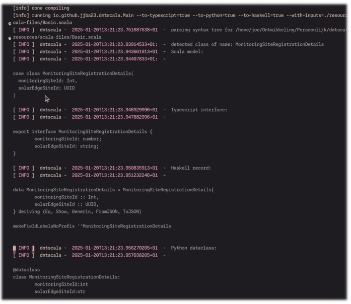
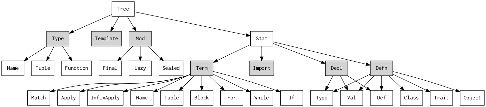

#+title: dmtscala
#+email: jjbigorra@gmail.com

dmtscala (DMT for short) aims to ease development in teams where Scala code is used by services written in other programming languages.

- Scala :: 2.13.14  

What if you could automatically convert data models into several languages?

/dmt is the Data Model Translator/ - if you use it enough you might start having visions (of Scala data models translated to Typescript, Haskell, Python and more)

For this purpose, we leverage the parsing abilities of Scalameta.

** Why ?

DMT can be highly beneficial for a company, saving money, time and preventing errors, particularly in environments like, for example:
- backend services are written in Scala and the frontend is built using TypeScript (e.g., with Angular, React, or Vue).
- mesh network of micro-services in different programming languages, where some services are written in Scala and others not

  

** Why not OpenAPI / Protobuf, etc?

It is a good question whether to use those intermediate data formats, but they are lossy in translation. A Scala Meta tree is lossless and as such it will allow for very interesting things, also as cross-references and more.

Some of the following ideas are feasible using dmtscala's approach in the future:
- it's fun to work with abstract syntax trees and build up different data types from them
- translate imports of commonly used packages (java.util.UUID -> Data.UUID)
- do interesting cross-referencing via packages, imports and more
- translate inline comments and documentation from language to language
- translate simple class methods and functions from language to language (think validations, or fullName = firstName + lastName)

** More advantages

Here's some more details about why this tool can be helpful:

*Unified Data Models*: DMT ensures that the same data structures are used across programs. This minimizes discrepancies between how data is represented and validated in both systems.

*Single Source of Truth*: By generating models directly from Scala models, you get one source of truth for data model definitions, reducing errors caused by manually maintaining separate models.

*Automation Saves Time*: Manually translating models is time-consuming and prone to human error. Automating this process accelerates development and allows developers to focus on more critical tasks.

*Prevents Runtime Errors*: Ensuring type alignment between programs reduces bugs that arise due to type mismatches or unexpected data formats.

*Clear Data Contracts*: A standardized approach to model translation makes it easier for developers (especially new team members) to understand and work with the data structures used across the stack.

*Cross-Team Coordination*: DMT fosters better collaboration between teams by clearly defining the data exchange contract.

*Rapid Iteration*: Changes to data models in Scala can be propagated automatically to other languages, enabling quick iterations and updates in both backend and frontend during development.

** Usage

dmtscala provides a friendly nice-to-use command-line-interface (CLI)

#+begin_example
user@host $ sbt "dmtscala/run -h"

Usage: dmtscala [options]

  --version                view dmtscala version details
  -h, --help               view dmtscala detailed usage information
  --silent                 silent flag will ensure dmtscala does not output any logging
  --to-python              to-python flag enables Python data model translation
  --to-typescript          to-typescript flag enables Typescript data model translation
  --to-haskell             to-haskell flag enables Haskell data model translation
  --with-inputs <file1>,<file2>,...
                           with-inputs specifies the Scala files to be read for translation
#+end_example

You *MUST* enable at least on programming language to translate to.

Example usage translating to multiple languages at the same time:

#+begin_example
user@host $ sbt "dmtscala/run --to-typescript=true \
        --to-python=true --to-haskell=true \
        --with-inputs=./resources/scala-files/Basic.scala"
#+end_example

** Talk is cheap, show code

When running DMT, it will save its output to files in the same directories as the inputs.

You can pass a string of comma separated file paths to DMT for translation.

See example outputs at: [[file:resources/scala-files/]]

If you pass e.g. ~./resources/scala-files/Basic.scala~ then files like ~./resources/scala-files/Basic.py~ and ~./resources/scala-files/Basic.ts~ will be created.

Here is how an example run looks like:

** Scala versions supported

dmtscala supports reading Scala 2.x files properly.

support for Scala 3 is as of now unknown.

** What is a syntax tree?
Syntax trees are a representation of source code that makes it easier to programmatically analyze programs. Scalameta has syntax trees that represent Scala programs.

Scalameta trees are lossless, meaning that they represent Scala programs in sufficient detail to go from text to trees and vice-versa. Lossless syntax trees are great for fine-grained analysis of source code, which is useful for a range of applications including formatting, refactoring, linting and documentation tools

Parse trees
Scalameta comes with a parser to produce syntax trees from Scala source code. You can parse trees from a variety of sources into different kinds of tree nodes.

** On specific languages

*** Typescript

The translated Typescript models should be ready to copy-paste right into your project with little to no dependencies.
You might need to fix and add some imports.

*** Haskell

The translated Haskell models assume that you will want to serialize/deserialize from JSON with the ~aeson~ library and that you will want to have ~TemplateHaskell~ enabled.
By default they will also generate lenses for the data models using the ~Optics~ package. You can customize dmtscala easily to stop this.
You might need to fix and add some imports.

*** Python

The translated Python models make use of ~marshmallow-dataclass~ style classes to serialize/deserialize from JSON.
You might need to fix and add some imports.

*** More languages

If you want to add support for your favourite language, please feel free to contribute to dmtscala or reach out to me <jjbigorra@gmail.com> so we can chat about it and evaluate difficulty and feasability.
